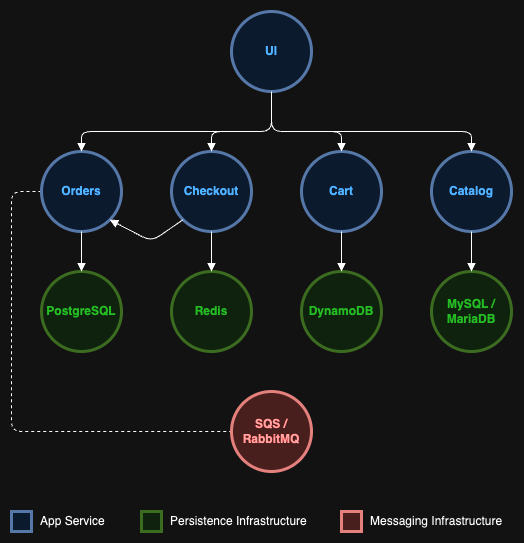

# Retail Store Sample Application

A multi-service retail store application demonstrating containerized services.
The application source, Dockerfiles, Compose configuration, and container
architecture are retained in this repository.

## Architecture



The application consists of:

| Service | Language | Purpose |
| --- | --- | --- |
| [UI](./src/ui/) | Java | Storefront |
| [Catalog](./src/catalog/) | Go | Product catalog |
| [Cart](./src/cart/) | Java | Shopping carts |
| [Orders](./src/orders/) | Java | Orders |
| [Checkout](./src/checkout/) | Node.js | Checkout orchestration |

For an explanation of how the source code, Dockerfiles, and Compose files fit
together, see [How the source code, Dockerfiles, and Compose fit together](./docs/docker-and-compose.md).

For step-by-step instructions on building individual Dockerfiles, pushing to container registries, running multi-containers per service, and launching the full application, see the [Docker Instructions & Local Deployment Guide](./DOCKER_INSTRUCTIONS.md).

## Run with Docker Compose

Prerequisite: Docker with the Compose plugin.

From the repository root, start the services:

```sh
DB_PASSWORD=testing docker compose \
  -f src/app/docker-compose.yml \
  -f src/app/compose.override.yaml \
  up --build
```

Open [http://localhost:8888](http://localhost:8888). Stop the services with
`Ctrl+C`, or run:

```sh
docker compose \
  -f src/app/docker-compose.yml \
  -f src/app/compose.override.yaml \
  down
```

## License

This project is licensed under the MIT-0 License; see [LICENSE](./LICENSE).
