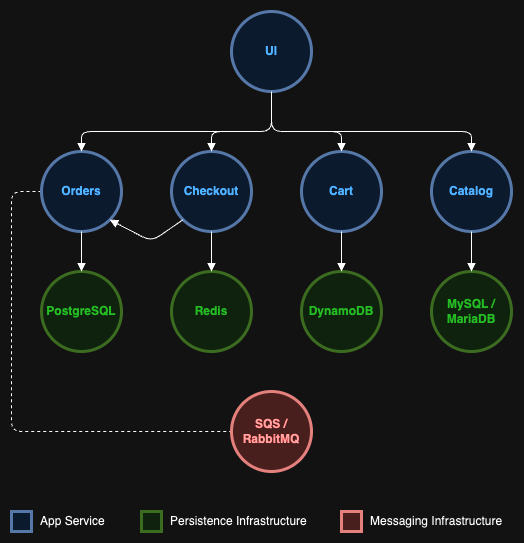
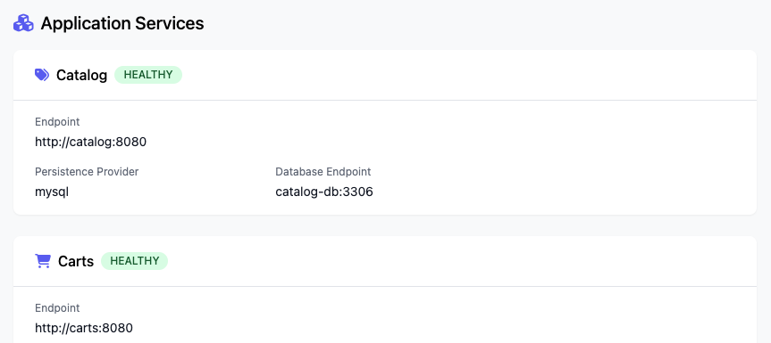

# How the source code, Dockerfiles, and Compose fit together

The project is split into application services. Each service has its own source
code, Dockerfile, and Compose file.



## From source code to running service

1. A service's source code lives in its directory. For example, Cart's Java
   code is in [`src/cart/src`](../src/cart/src/), and Catalog's Go code is in
   [`src/catalog`](../src/catalog/).
2. Its `Dockerfile` describes how to build a container image. For example,
   [Cart's Dockerfile](../src/cart/Dockerfile) first compiles the Java source
   into a JAR, then places that JAR in a smaller runtime image.
3. The service's `docker-compose.yml` describes how to run that image: its
   settings, network ports, health check, and supporting services. The
   [Cart Compose file](../src/cart/docker-compose.yml), for example, runs Cart
   alongside a local DynamoDB container and configures Cart to use it.

In short:

```text
service source code + Dockerfile -> container image
container image + Compose settings -> running container
```

## Running the whole application

[`src/app/docker-compose.yml`](../src/app/docker-compose.yml) includes the
Compose files for the UI, Catalog, Cart, Checkout, and Orders. This lets Compose
build and run the services together, rather than starting each service
individually.

[`src/app/compose.override.yaml`](../src/app/compose.override.yaml) adds
full-stack settings, including the UI's backend URLs and service health
dependencies. Inside the Compose network, services can reach each other by
service name, such as `http://catalog:8080`. The app's Compose configuration
also controls which ports are exposed to the host.

The topology image shows example service and database endpoints once the stack
is running:



From the repository root, start the stack with:

```sh
DB_PASSWORD=testing docker compose \
  -f src/app/docker-compose.yml \
  -f src/app/compose.override.yaml \
  up --build
```

`--build` asks Compose to build the service images from their Dockerfiles before
starting the containers. See the [README](../README.md) for how to access and
stop the application.
